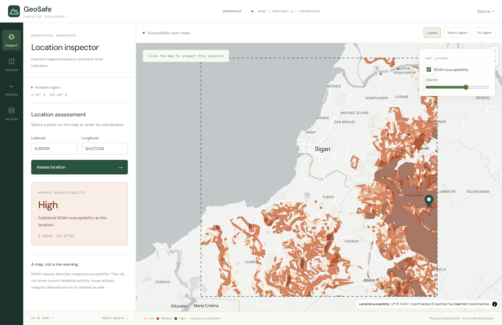

# GeoSafe

A map-based workspace for landslide susceptibility, satellite change analysis, and measured sensor observations. Developed from work submitted to the PhilSA Space Business Innovation Challenge 2025.

## Features

- NOAH susceptibility maps and native-detail location assessment.
- Map-drawn analysis regions and adjustable layers.
- Sentinel-2 vegetation comparison, moisture indicators, and terrain analysis without Earth Engine.
- Pixel inspection, coverage statistics, and baseline/recent comparison.
- Measured sensor CSV uploads and georeferenced GeoTIFF exports.

**Stack:** React, TypeScript, MapLibre, FastAPI, Rasterio, NumPy.

`frontend/` deploys to Vercel; `backend/` deploys to Render from this same repository.

[Development](docs/DEVELOPMENT.md) · [Deployment](docs/DEPLOYMENT.md) · [Data attribution](backend/data/NOTICE.md)

Published susceptibility and relative satellite scores are distinct. Neither is a live landslide warning; missing coverage is not evidence of safety.
